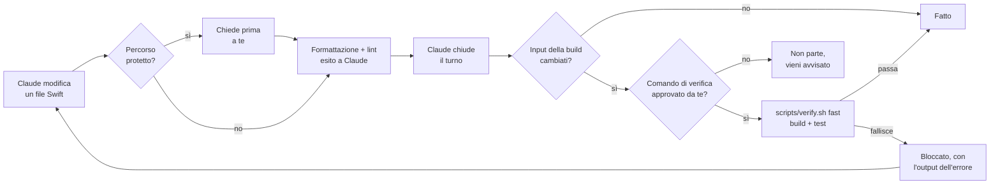

<p align="center">
  
</p>

<p align="center">
  <a href="https://github.com/davidelarocca/swift-harness/actions/workflows/ci.yml"></a>
  <a href="https://github.com/davidelarocca/swift-harness/releases/latest"></a>
  
  
  <a href="LICENSE"></a>
</p>

<p align="center">
  <b>Un plugin di Claude Code per app macOS native.</b><br>
  Un metodo "riusa prima di creare" per il design system SwiftUI e controlli a fine di ogni turno<br>
  (build e test, lint, layout, accessibilità, snapshot, impostazioni di sicurezza, documentazione),<br>
  così Claude resta coerente mentre il progetto cresce, e vedi cosa è stato controllato e cosa è stato fermato.
</p>

<p align="center">
  <a href="#come-iniziare">Come iniziare</a> ·
  <a href="#come-funziona">Come funziona</a> ·
  <a href="#configurazione">Configurazione</a> ·
  <a href="ROADMAP.md">Roadmap</a> ·
  <a href="README.md">English</a>
</p>

```
/plugin marketplace add davidelarocca/swift-harness
/plugin install swift-harness@swift-harness
/swift-harness:setup
```

<p align="center">
  
  <br>
  <sub>Una sessione reale di Claude Code. Il controllo a fine turno intercetta un test che fallisce, Claude lo dice invece di nasconderlo, e lo corregge quando glielo chiedi.</sub>
</p>

## Perché

I piani step by step tengono ogni sessione concentrata, ma non impediscono la deriva tra uno step e l'altro. Con la crescita del progetto lo stesso elemento (una pillola di notifica, un bottone con hover, un popover) viene ricostruito in modo leggermente diverso in ogni feature, i valori grezzi si spargono nelle view e arrivano bug visivi e strutturali.

swift-harness interviene su quattro livelli:

1. **Il design system sta nel codice**, non nei documenti: token e componenti condivisi in un Swift package locale.
2. **Claude sa dove guardare**: un `CLAUDE.md` corto, rules legate ai percorsi, un registro dei componenti e gli ADR, caricati solo quando servono.
3. **I controlli sono automatici**, non richieste: gli hook formattano, controllano e verificano, quindi "non mettere valori a mano" diventa qualcosa che Claude non può saltare.
4. **Il harness si misura, non si dà per buono**: difetti piantati apposta mostrano quale controllo trova cosa, uno score di deriva segue la coerenza del progetto commit per commit, e ogni turno finisce con un riepilogo di cosa è stato controllato e cosa no.

## Come funziona



| Tipo | Nome | Cosa fa |
|---|---|---|
| Skill (la lanci tu) | `/swift-harness:setup` | Prepara un progetto nuovo o esistente: `CLAUDE.md`, `.claude/rules/`, `docs/` (architettura, design system, registro componenti, product map, contratto di layout, template ADR), `.swiftlint.yml`, formatter, `scripts/verify.sh`, config degli hook. Non sovrascrive mai file esistenti. `/swift-harness:setup audit` prima riporta, in sola lettura, cosa il progetto ha già (regole, comandi, controlli, ciascuno con come lo si sa) e propone la configurazione ospite. `/swift-harness:setup guest` aggiunge solo `.claude/swift-harness.json` e uno `scripts/verify.sh` che lancia i comandi del progetto, per un progetto che tiene le sue regole, la sua documentazione e i suoi controlli. |
| Skill (la lanci tu) | `/swift-harness:approve-verify` | Mostra il comando di verifica del progetto e i file che esegue, poi lo approva per il controllo a fine turno. Puoi lanciarla solo tu. `/swift-harness:approve-verify revoke` toglie l'approvazione. |
| Skill (la lanci tu) | `/swift-harness:approve-snapshots` | Mostra le nuove immagini lasciate dagli snapshot test falliti (con i pixel cambiati in rosso) e copia quelle che approvi nella cartella delle baseline. Puoi lanciarla solo tu: i test non scrivono mai una baseline. |
| Skill (la lanci tu) | `/swift-harness:approve-performance` | Mostra i nuovi numeri lasciati dai test del budget di prestazioni (una prima baseline, una regressione, un guadagno o un altro Mac) e copia in `performance/` quelli che accetti. Solo tu puoi lanciarla: né i test né Claude scrivono mai una baseline. |
| Skill (la lanci tu) | `/swift-harness:approve-security` | Mostra cosa è cambiato nelle impostazioni di sicurezza dell'app dall'ultima approvazione (entitlements, App Transport Security, impostazioni di build di sandbox e hardened runtime), dice quali modifiche indeboliscono la protezione e le registra come nuova baseline se sei d'accordo. Fino ad allora il controllo a fine turno fallisce. |
| Skill (la lanci tu) | `/swift-harness:check-sensitivity` | Pianta un difetto alla volta in una copia temporanea del progetto (una voce del registro o una vista del layout rinominata, un link della documentazione rotto, un entitlement allargato, una dipendenza vietata; con `--verify`, attraverso i tuoi test e SwiftLint: un padding a mano, una scorciatoia o un'etichetta di accessibilità tolta, una vista più larga del minimo, un padding cambiato) e dice quale controllo l'ha trovato. Un difetto che nessuno trova è un risultato da spiegare. Il progetto non viene mai modificato. |
| Skill (la lanci tu) | `/swift-harness:drift` | Misura la deriva ora o per ogni commit di un intervallo git: valori di design a mano contro token, componenti nuovi con il ruolo di uno registrato, e i problemi dei controlli di registro, layout, documentazione e contratti, in un solo score per commit. Testo o JSON. |
| Skill (la lanci tu) | `/swift-harness:report` | Cosa hanno fermato i controlli in questo progetto, da un registro locale tenuto dagli hook: blocchi a fine turno e come sono finiti (corretti da Claude, lasciati fallire), segnalazioni di lint e del registro, domande prima di modifiche protette, le tue approvazioni, e i controlli che non sono girati, con il perché. `html` scrive una pagina statica. Niente lascia la tua macchina. |
| Skill (la lanci tu) | `/swift-harness:doctor` | Controllo in sola lettura della configurazione: strumenti, chiavi e valori della config, segnaposto `{{...}}` rimasti, script di verifica e approvazione, config del formatter, struttura del progetto e ultima verifica. Una riga PASS / WARN / FAIL per controllo, con la correzione. Non modifica file. |
| Skill (la lanci tu) | `/swift-harness:audit` | Audit in sola lettura di architettura, coerenza della UI e salute del codice, con report e piano di migrazione. |
| Skill (la lanci tu) | `/swift-harness:product-map` | Mappa del prodotto ricavata dal codice, in sola lettura: entità, le loro pagine, ogni punto in cui compaiono, relazioni, raccolte gestite dall'utente e azioni. Elenca i buchi con le prove: elementi che non si aprono da dove sono mostrati, entità collegate mostrate come testo semplice, liste che non si possono rinominare o riordinare, azioni che mancano in alcuni punti. Scrive `docs/PRODUCT_MAP.md` dopo la tua approvazione. |
| Skill (la lanci tu) | `/swift-harness:port-to-ios` | Valutazione in sola lettura di un'app macOS per iOS: ogni modulo e funzione classificati come condivisibile così com'è, con adattatore, adattamento della UI, da ridisegnare o non disponibile, con prove `file:riga` da `scripts/porting.sh`; opzioni di struttura dei target a confronto; uno stato per piattaforma che non dice mai pronto senza build e test. Build di prova per il simulatore iOS solo con il tuo sì. Scrive `docs/PORTING_PLAN.md` e nient'altro. |
| Skill (automatica) | `ui-change` | Procedura "riusa prima di creare" per ogni modifica di interfaccia: cerca nel registro e nel codice, decide se riusare, estendere o creare, implementa con i token, prepara le preview di ogni stato, aggiorna il registro. Un'entità mostrata in un punto nuovo mantiene i collegamenti e le azioni che ha altrove, secondo `docs/PRODUCT_MAP.md`. |
| Skill (automatica) | `design-system` | Struttura del package, token, presenter condiviso per pillole e toast, stili dei bottoni, gallery, snapshot test, migrazione dai valori hardcoded. Con file Swift di riferimento. |
| Skill (automatica) | `feature` | Ciclo Discover, Plan, Implement, Verify, Record per ogni feature o step. |
| Skill (automatica) | `adr` | Registra una decisione architetturale e la indicizza. |
| Subagent | `ui-reviewer` | Review in sola lettura di un diff contro design system, registro, product map e regole di architettura. |
| Hook | SessionStart | Fissa lo stato di partenza del codice come riferimento (non come verificato), avvisa se l'ultima verifica è fallita sullo stesso codice, dice a Claude quando il comando di verifica non è approvato e segnala strumenti mancanti. Dopo una compattazione del contesto dà invece a Claude un breve checkpoint di fatti: branch, file cambiati nella sessione, esito della verifica sul codice attuale, cosa aspetta una tua decisione, i documenti da rileggere. |
| Hook | PreToolUse | Chiede conferma prima che Claude modifichi `project.pbxproj`, un percorso protetto o una baseline degli snapshot con i tool Edit o Write. Con `guardBash`, anche prima di un comando shell che scrive lì. Non è una sandbox: vedi [Limiti](#limiti). |
| Hook | PostToolUse | Formatta e controlla il file Swift appena modificato (solo file dentro il progetto); esito del lint, modifiche ed errori del formatter ed errori di configurazione di SwiftLint tornano a Claude. Dopo una modifica a `Package.swift` controlla il contratto di architettura. |
| Hook | Stop | Esegue la verifica veloce e il controllo del contratto di architettura prima che Claude chiuda il turno, solo se sono cambiati input della build (codice Swift, impostazioni di progetto e build, risorse) e solo dopo che hai approvato il comando. Ti avvisa se il contratto è cambiato durante la sessione, e se le baseline degli snapshot sono cambiate senza `/swift-harness:approve-snapshots`, anche tramite comandi shell. Inoltre: le impostazioni di sicurezza cambiate dalla tua approvazione fanno fallire il controllo; i file protetti cambiati fuori da Edit e Write ti vengono segnalati. E dice a te e a Claude quando la sessione ha indebolito un controllo: test o asserzioni rimossi, skip aggiunti, `swiftlint:disable` aggiunto, una regola spenta o un percorso escluso in `.swiftlint.yml`, una `tolerance:` più larga, una riga del contratto di layout rimossa o il suo Min abbassato, un componente uscito dai Components del registro. |

Il costo fisso di contesto è di circa 770 token per sessione; le skill caricano le istruzioni complete solo quando servono. Gli hook sono **spenti in ogni progetto che non contiene `.claude/swift-harness.json`**: gli altri progetti non vengono toccati.

<details>
<summary><b>Come si comporta il controllo a fine turno</b></summary>

- Il comando di verifica parte solo dopo che lo approvi con `/swift-harness:approve-verify`. L'approvazione vale per il percorso del progetto, il comando e il contenuto di ogni file che il comando nomina, ed è salvata fuori dalla repo. Un altro worktree git della stessa repository la eredita quando il comando e quei file sono identici (qualsiasi differenza la richiede di nuovo; un altro clone non la eredita mai). Uno script chiamato da quei file è coperto solo se è in `verify.inputs`: lo stato e `/swift-harness:doctor` nominano gli script che trovano citati e non coperti, leggendo i file come testo. Finché manca, o dopo che uno di questi cambia, il controllo non lo esegue e ti avvisa una volta per stato del codice; `lintBlocking` resta attivo.
- Codice invariato dall'inizio della sessione o dall'ultima verifica riuscita: non parte nulla. Lo stato di partenza è un riferimento, non una verifica superata: se era già rotto, la prima modifica della sessione fa partire la verifica e lo mostra.
- Codice cambiato e verifica fallita: Claude viene bloccato e riceve le ultime 60 righe dell'output.
- Claude prova a fermarsi di nuovo senza modificare nulla: può fermarsi, e ricevi un avviso.
- Dopo `maxAttempts` fallimenti consecutivi (default 3): si ferma e decidi tu.
- Con `lintBlocking: true`, i file che non hanno passato SwiftLint dopo una modifica vengono ricontrollati qui. Un hook non può annullare una modifica già fatta, quindi è qui che viene intercettata: il turno non risulta superato finché quei file non sono puliti.
- "Cambiato" vale per ogni input della build: file Swift (compreso `Package.swift`), `Package.resolved`, workspace, `.pbxproj`, `.xcconfig`, plist, entitlements, cataloghi di asset e stringhe, cartelle `Resources/`, tutto ciò che sta nelle cartelle SwiftPM `Sources/` e `Tests/` (risorse, fixture), snapshot di riferimento, `scripts/`, configurazione di lint e dell'harness. `.build`, DerivedData, lo stato utente di Xcode (`xcuserdata`) e `.DS_Store` sono ignorati.
- Un risultato vale per il codice e per la versione del plugin. Dopo un aggiornamento del plugin, un esito registrato dalla versione precedente non conta più. Il codice invariato non viene rieseguito da solo: il controllo gira alla fine del primo turno che cambia input della build, e fino ad allora `/swift-harness:doctor` mostra il codice come non verificato.
- Un fallimento sopravvive a una nuova sessione: all'avvio o al resume Claude viene avvisato se l'ultima verifica è fallita sul codice attuale.
- Funziona per worktree, quindi agenti paralleli verificano ciascuno la propria copia.
- I docs si controllano a parte, con `scripts/docs.sh`, che legge solo Markdown: un link a un file o a un titolo che non esiste, un percorso tra backtick che non esiste (non in ADR, audit e archivi), una sezione nominata tra virgolette accanto a un documento che non ce l'ha, un import `@` di un file mancante, e i file letti in ogni sessione (`CLAUDE.md` e i suoi import) oltre `docs.budget` byte. Ogni problema viene dato come `file:riga`. Bloccano il turno, una volta, solo i problemi nuovi della sessione; quelli che c'erano già all'inizio li mostra `/swift-harness:doctor`. I docs non sono un input della build, quindi modificarli non rilancia mai il comando di verifica.

</details>

<details>
<summary><b>Contratti di architettura (SwiftPM)</b></summary>

In un progetto diviso in target SwiftPM il compilatore fa rispettare le dipendenze dichiarate, ma non protegge le dichiarazioni: per far compilare una modifica un agente può aggiungere `"Services"` al target `UI` in `Package.swift`, e il confine sparisce. `docs/architecture-contracts.json` elenca le dipendenze ammesse per ogni target (esempio nel [README in inglese](README.md#how-it-works)).

- Le chiavi sono le cartelle dei package rispetto al repository (`"."`, `"Packages/Core"`). I target locali si scrivono come in `Package.swift`, i prodotti di altri package come `package/prodotto`. Ciò che non è elencato non è ammesso, e fallisce anche un target assente dal contratto: un modulo nuovo è una decisione. I target di test sono controllati solo se elencati.
- Il grafo viene da `swift package dump-package`, senza analizzare il sorgente Swift. Il controllo gira a fine turno quando sono cambiati input della build e subito dopo che Claude modifica un `Package.swift`, solo dopo che hai approvato il comando di verifica: leggere il manifest lo esegue, come fa la build.
- Una violazione blocca il turno indicando package, target e dipendenza. Per ammettere una dipendenza nuova aggiungila al contratto, meglio con un ADR.
- Se il contratto cambia durante la sessione, a fine turno vedi le dipendenze ammesse aggiunte e tolte. Claude può comunque modificarlo (aggiungilo a `protectedPaths` perché le modifiche chiedano conferma), ma non in silenzio.
- `/swift-harness:doctor` controlla il file e le cartelle dei package senza eseguire alcun manifest. Un progetto senza package SwiftPM, o con un solo target, non ha nulla da controllare.

</details>

<details>
<summary><b>Un registro dei componenti che resta vero</b></summary>

Claude legge `docs/COMPONENT_REGISTRY.md` prima di costruire la UI, quindi una voce sbagliata lo manda verso un file spostato o un tipo rinominato. Il registro viene controllato come il codice:

- A fine turno, quando sono cambiati il codice o il registro: ogni File esiste e dichiara il Name (`struct`, `class`, `func`, ...), ID e nomi sono unici, un ID in Retired non è più elencato. Un problema blocca il turno indicando la riga del registro, come una build fallita. Legge solo Markdown, quindi gira senza l'approvazione del comando di verifica.
- Dopo che Claude modifica un file in `registry.sources`: una nota indica le view, i modifier e gli stili di quel file che il registro non elenca, e le voci che puntano a quel file, come promemoria per aggiornarle nella stessa modifica. Non blocca.
- `/swift-harness:doctor` mostra l'esito e ogni componente non elencato.

Le colonne si trovano dall'intestazione: la tabella Components deve avere Name e File. Un registro in un altro formato viene segnalato da doctor e non blocca mai. "Componente" vuol dire un tipo di primo livello, non privato, conforme a `View`, `ViewModifier`, `Layout`, `Shape`, a un representable AppKit o UIKit o a un protocollo `*Style`: presenter e altri tipi condivisi vengono controllati se elencati, ma non rilevati se mancano. Le view non pensate per il riuso (gallery, pezzi di un componente) vanno sotto Internal. Quale componente riusare resta una scelta di Claude, guidata dal registro e dalla skill `ui-change`.

</details>

<details>
<summary><b>Schermate che reggono a ogni dimensione della finestra</b></summary>

Claude costruisce una schermata alla dimensione della sua preview. `docs/LAYOUT_CONTRACT.md` dà a ogni schermata principale le dimensioni che deve reggere: Min, Default, Max, una larghezza sotto la quale passa a un layout compatto e cosa cambia lì, e i popover e le finestre che apre. I test del progetto la misurano:

```swift
#expect(LayoutContract.check("LibraryView") { LibraryView() } == [])     // il contenuto
#expect(LayoutContract.check("LibraryWindow") { LibraryWindow() } == []) // la finestra che lo mostra
```

- `LayoutContract.check` (copiato dal setup in un target di test, da `templates/tests/LayoutContract.swift`) propone alla view ogni dimensione della riga con `NSHostingController.sizeThatFits(in:)` e segnala ogni dimensione in cui il contenuto chiede più spazio: "at 560x400 it needs 857 pt of width". Per la finestra controlla che il minimo dichiarato sia Min, così non si stringe fino a sparire né si ferma sopra Min, e che non cresca oltre Max. In un target di test di un package girano in `scripts/verify.sh fast`, quindi un layout che si rompe blocca la fine del turno come un test fallito; in un target di test Xcode lo script generato esegue i test solo in modalità `full`.
- A fine turno `scripts/layout.sh` controlla il contratto stesso: ogni View esiste nel suo File, ogni Window è dichiarata, ognuna è misurata da un test, le dimensioni sono dimensioni. Legge Markdown e Swift come testo, quindi gira senza l'approvazione del comando di verifica.
- Dopo che Claude modifica un file che disegna una schermata del contratto, una nota ne indica le dimensioni. `ui-change`, la regola sulla UI e `ui-reviewer` leggono il contratto; il reviewer controlla ciò che i test non vedono.

Una view che accetta qualsiasi larghezza e non ne chiede nessuna non si può misurare, e il controllo fallisce dicendo cosa fare invece di passare: `NavigationSplitView`, `HSplitView`, `List` e `Table` tagliano ciò che non ci sta senza dirlo. Quasi tutte le finestre principali sono split view, quindi le pagine della colonna di dettaglio e la sidebar hanno righe proprie. Un contenuto che accetta qualsiasi larghezza ma ne ha una sua (testo che va a capo, o un `.frame(minWidth: 0, maxWidth: .infinity)` che nasconde il contenuto) non si può distinguere: passa con una nota nell'output dei test. Trovato su un'app di ~97k righe, dove entrambe le schermate principali passavano senza essere misurate.

Il contenuto si misura senza il frame della finestra: un `.frame(minWidth:)` attorno a una view nasconde il contenuto più largo del frame, quindi il minimo della finestra va in una piccola view della finestra, misurata a parte. Sull'app in esecuzione, un test di interfaccia guarda cosa mostra davvero la finestra. `LayoutAudit` (da `templates/tests/LayoutAudit.swift`) legge una volta l'albero di accessibilità e fallisce per ogni elemento tagliato dal bordo della sua finestra, sheet o popover fuori da una scroll view, e per ogni testo sopra un altro testo, con i frame:

```swift
LayoutAudit.shrinkWindow(app)   // macOS: trascina la finestra alla dimensione minima
try LayoutAudit.check(app)      // 'play' is cut by the left edge: (417, 390, 150x24) in (510, 285, 280x312)
```

Funziona su macOS e su un simulatore iOS (iPhone, iPad, il testo dinamico più grande con `LayoutAudit.largestText`), misurato su un fixture in CI: due pulsanti tagliati e due etichette sovrapposte vengono trovati, una lista che scorre oltre il suo bordo no, la schermata corretta passa. I frame dell'albero non sono ritagliati, ed è questo che rende misurabile un bordo. Trova anche l'overflow che `.frame(minWidth: 0, maxWidth: .infinity)` nasconde a `LayoutContract`. Non misurati: testo troncato dal proprio frame, contenuto sotto la barra di stato di iOS, e dove si aprono i popover; sono controlli di review, sugli screenshot quando il progetto li cattura (sotto).

</details>

<details>
<summary><b>Design review sugli screenshot</b></summary>

Il codice mostra token e modifier, non se le righe sono allineate o se due schermate si somigliano. I test del progetto possono salvare immagini di ogni schermata per l'agente `ui-reviewer`:

```swift
#expect(Screenshot.capture("LibraryView") { LibraryView() } == [])
```

- `Screenshot.capture` (copiato dal setup accanto a `LayoutContract.swift`, da `templates/tests/Screenshot.swift`) disegna la schermata in una finestra fuori schermo alle dimensioni Min e Default della sua riga del contratto, o a quelle che passi, in chiaro e scuro, e salva immagini PNG con un `.json` accanto (schermata, stato, lingua, piattaforma, dimensione, scala, OS, file sorgente) in `.build/swift-harness/screenshots/`. In un target di test di un package gira in `scripts/verify.sh fast` a ogni fine turno, quindi le immagini seguono il codice; in un target di test Xcode, in modalità `full`. Una cattura che sembra una finestra vuota viene segnalata come problema; una view di un solo colore viene salvata. Il reviewer segnala come vecchia un'immagine più vecchia del suo file sorgente.
- `ui-reviewer` apre le immagini delle schermate cambiate e di quelle vicine e riporta ciò che vede: bordi non allineati, spaziature diverse tra schermate costruite allo stesso modo, gerarchia, troncamenti, contrasto in modalità scura. Ogni osservazione indica l'immagine e il `file:line` che la disegna. Sono note di review, non un blocco: il confronto con immagini approvate lo fanno gli snapshot test (sotto).
- Perché una finestra: `ImageRenderer` disegna un segnaposto per `List` e altri controlli basati su AppKit, e `NSView.cacheDisplay` perde il testo SwiftUI. La cattura dal window server mostra la schermata come la disegna l'app.

Misurato su una piccola fixture, 3 esecuzioni per braccio ([risultati](tests/smoke/RESULTS.md)): i difetti inseriti nel codice sono stati trovati con e senza immagini; con le immagini il reviewer ha dato posizioni invece di ipotesi, non ha mai descritto male il layout e ha trovato un difetto di rendering che la review del solo codice ha mancato ogni volta.

</details>

<details>
<summary><b>Visual regression con baseline approvate</b></summary>

Un componente condiviso cambiato per una schermata può spostare tutte le altre che lo usano. I test del progetto confrontano ogni componente con immagini che hai approvato:

```swift
#expect(Snapshot.verify("PillView", sizes: ["320"], state: "long-text") { PillView(pill: .success(longTitle)) } == [])
#expect(Snapshot.verify("PillView", sizes: ["320"], locale: "ar") { PillView(pill: .success("Added")) } == [])
```

- `Snapshot.verify` (copiato dal setup accanto a `Screenshot.swift`, da `templates/tests/Snapshot.swift`) disegna la view come gli screenshot, in chiaro e scuro, e confronta ogni immagine con la sua baseline in `snapshots/`. `locale:` imposta lingua e direzione del testo, così una gallery copre lingue lunghe e scrittura da destra a sinistra.
- Un test non scrive mai una baseline. Un'immagine mancante o diversa fallisce e indica la zona cambiata ("85 of 151200 pixels differ, within x 96-110, y 118-126 pt"); la nuova immagine e una copia con i pixel cambiati in rosso restano in `.build/swift-harness/snapshots/`. Le guardi e le approvi con `/swift-harness:approve-snapshots`, che le copia in `snapshots/` da committare.
- Claude non può sostituire una baseline in silenzio: il guard chiede conferma prima di un Edit o Write in `snapshots/`, e a fine turno vieni avvisato delle baseline cambiate senza approvazione, anche tramite comandi shell. In sessioni reali Claude ha lasciato l'approvazione all'utente anche quando gli è stato chiesto di aggiornare le baseline ([risultati](tests/smoke/RESULTS.md)).
- Le baseline sono legate alla versione di macOS e alla scala del display su cui sono state fatte. Su un'altra versione un'immagine risulta non confrontata, mai uguale.

</details>

<details>
<summary><b>Tastiera, ordine del focus e Riduci movimento</b></summary>

Un componente che funziona solo col puntatore, o una schermata in cui il Tab salta qua e là, passa ogni altro controllo. Il setup offre due helper di test, costruiti su ciò che un test riesce a vedere su macOS 26 e 27 (misurato):

```swift
let keys = KeyboardCheck.host { SaveBar(onSave: { saved = true }, onCancel: { cancelled = true }) }
keys.press(.return)                        // l'azione predefinita
keys.press(.escape)                        // annulla, onExitCommand, onKeyPress
keys.press("f", modifiers: .command)       // la sua scorciatoia

try FocusOrder.check(app, ["search", "sort", "play", "shuffle", "trackList"])   // un test di interfaccia
```

- `KeyboardCheck` (test unitari, da `templates/tests/KeyboardCheck.swift`) ospita una view in una finestra fuori schermo e le manda tasti; il test verifica cosa ha fatto l'azione. In un target di test di un package gira in `scripts/verify.sh fast`. Non può controllare il Tab né l'ordine del focus (un processo di test non ha il ciclo delle view da tastiera), i comandi di menu, né le scorciatoie che differiscono solo per Maiuscolo (SwiftUI le confonde in un processo di test; l'app vera no).
- `FocusOrder` (test di interfaccia, da `templates/tests/FocusOrder.swift`) preme Tab nell'app avviata e controlla che il focus visiti i controlli nell'ordine dato, torni al primo, e che Maiuscolo-Tab torni indietro. I controlli entrano nel ciclo del Tab solo con la navigazione da tastiera attiva in Impostazioni di Sistema: se è spenta il test viene **saltato**, mai superato. La CI la accende con `defaults write -g AppleKeyboardUIMode -int 2`. macOS non ha un'API pubblica per il focus da tastiera nei test di interfaccia; l'helper legge un attributo non documentato e fallisce, invece di passare, se smette di funzionare.
- Riduci movimento non si può attivare da un test (`accessibilityReduceMotion` è di sola lettura). Il riferimento del design system ha `@ReduceMotion`, che un test o una preview sovrascrivono con `.environment(\.reduceMotionOverride, true)`, e `Motion.moving(_:reduced:)`, che toglie un'animazione di movimento o trasforma una transizione di movimento in una dissolvenza. La regola `ds_motion_without_reduce` segnala le transizioni di movimento che lo saltano.
- Resta alla review: azioni raggiungibili solo con clic o hover, anelli di focus, Esc sulla UI presentata, scorciatoie di menu e animazioni avviate con `withAnimation`.

</details>

<details>
<summary><b>Budget di prestazioni con baseline approvate</b></summary>

Una modifica può rendere più lenta un'operazione chiave (lavoro spostato sul main actor, una lista costruita tutta subito, gli stessi dati decodificati due volte) e tutti i test continuano a passare. Il setup offre un budget per le due o tre operazioni che contano:

```swift
final class LibraryBudgetTests: XCTestCase {
    func testLoadingTenThousandSongs() {
        let data = Fixtures.library(count: 10_000)
        XCTAssertEqual(PerformanceBudget.verify("LoadLibrary-10k") { _ = Library.load(data) }, [])
    }
}
// LoadLibrary-10k: 584.29 M instructions, 65.2% over the approved 353.71 M (tolerance 5.0%); CPU time 24.01 ms, was 12.54 ms.
```

- `PerformanceBudget.verify` (da `templates/tests/PerformanceBudget.swift`) esegue l'operazione 3 volte per scaldarla, poi 15, e confronta la mediana delle istruzioni eseguite dal processo di test con una baseline che hai approvato. Oltre il 5% in più fallisce con i numeri; oltre il 5% in meno passa e lascia i numeri da approvare, così un guadagno si può tenere. In un target di test di un package gira in `scripts/verify.sh fast`, quindi una regressione blocca la fine del turno.
- Perché le istruzioni: misurato in [#33](https://github.com/davidelarocca/swift-harness/issues/33). Su un Mac variano di circa lo 0,25% tra un'esecuzione e l'altra dello stesso codice, mentre il tempo si muove di qualche punto percentuale, e molto di più su una macchina occupata. Decodificare due volte gli stessi dati le ha alzate del 64%.
- Le baseline stanno in `performance/` (`performance.path`), legate all'architettura, alla versione di macOS e alla configurazione di build. I test non le scrivono mai: lo fa `/swift-harness:approve-performance`, dopo che hai visto i numeri. Il guard chiede conferma prima che Claude modifichi la cartella, e l'avviso di fine turno segnala le modifiche fatte senza approvazione.
- Non confrontati, con i numeri stampati: sulle macchine virtuali, come i runner macOS di GitHub, che non contano le istruzioni e dove il tempo varia del ±20% tra un'esecuzione e l'altra (una regressione del 64% si nasconde in quel rumore); e su un'altra architettura, versione di macOS o configurazione di build.
- Il conteggio è dell'intero processo di test. I test eseguiti in contemporanea lo gonfiano, quindi i budget vanno in una classe XCTest, che esegue un test alla volta. Quando le iterazioni si discostano di più del 2%, il risultato è "unstable" e fallisce: non è una misura.

</details>

<details>
<summary><b>Gli stessi controlli per altri agenti, git hook e CI</b></summary>

`scripts/check.sh` esegue il controllo di fine turno fuori da Claude Code, con la stessa approvazione, lo stesso riepilogo delle prove e lo stesso registro, come una sessione con il nome dell'agente (`--agent codex`). Esce con 0 quando il comando di verifica è passato su questo codice, 1 quando un controllo è fallito, 3 quando il comando di verifica non è girato (non approvato, o spento). Un risultato parziale (una piattaforma non controllata) o instabile (fallito una volta, passato alla seconda) esce con 0 ed è nominato nell'output e in `--json`; con `--strict` esce con 4. Trova da solo la cartella dati del plugin, o usa `CLAUDE_PLUGIN_DATA`. Ricette, con il plugin installato dal marketplace:

```bash
# dove è installato il plugin (cambia a ogni versione)
SH="$(jq -r '.plugins["swift-harness@swift-harness"][0].installPath' ~/.claude/plugins/installed_plugins.json)"

# .git/hooks/pre-commit: il commit si ferma quando un controllo fallisce
"$SH/scripts/check.sh" --agent git-hook

# nelle regole di un altro agente (AGENTS.md): prima di finire, lancia questo e correggi quello che segnala
"$SH/scripts/check.sh" --agent codex
```

In CI non c'è una cartella di approvazioni: lì lancia direttamente il comando di verifica del progetto.

**Codex esegue gli stessi hook.** `setup-guest.sh --codex` (o `/swift-harness:setup guest` quando dici che sul progetto lavora anche Codex) scrive `.codex/hooks.json` e un piccolo launcher accanto. Codex esegue poi, ai suoi eventi:
- il guard prima di una modifica. Codex non può chiederti nulla da un hook, quindi una modifica su cui il guard chiederebbe viene rifiutata, e a Codex viene detto di fermarsi e chiederti prima. Se sei d'accordo, lancia `bash .codex/swift-harness-hook.sh --allow <file>` nel tuo terminale: un permesso, per quel file, per una patch entro un'ora;
- i controlli dopo una modifica, letti dalle patch di Codex;
- il controllo di fine turno. Un fallimento tiene Codex al lavoro, come Claude.

L'approvazione, il riepilogo delle prove e il registro sono gli stessi di Claude Code, e nominano l'agente. Codex chiede di fidarsi degli hook del progetto (`/hooks`), per ogni checkout. Con `--local`, anche i file di Codex restano fuori da git.

Per approvare il comando di verifica senza Claude Code, lancialo nel tuo terminale, non tramite Codex, con la cartella del plugin e la cartella dati scritte in `.codex/swift-harness-hook.sh`. Il primo comando mostra il comando, i suoi file e un digest; dopo averli controllati, il secondo approva:

```bash
CLAUDE_PLUGIN_DATA=<cartella dati> <cartella plugin>/scripts/approve-verify.sh --status <progetto>
CLAUDE_PLUGIN_DATA=<cartella dati> <cartella plugin>/scripts/approve-verify.sh --approve <digest> <progetto>
```

Limiti: un comando shell lanciato da Codex non passa dal guard, viene solo segnalato a fine turno. Un nuovo worktree senza questi file non esegue nessun controllo, e Codex non riceve avvisi, perché lì non si carica niente di swift-harness: quando ne crei uno, lancia `setup-guest.sh --project <worktree> --from <checkout> --local`.

</details>

<details>
<summary><b>Misurare il harness: riepilogo delle prove, registro, deriva e sensibilità dei controlli</b></summary>

- **Un riepilogo a ogni fine turno.** Il controllo di fine turno scrive cosa ha eseguito, su quale codice, con quale risultato, e perché qualcosa non è girato (comando di verifica non approvato, SwiftLint mancante). Te lo dice solo quando qualcosa non è stato controllato; `/swift-harness:doctor` e il checkpoint dopo una compattazione lo mostrano. La skill `ui-change` e l'agente `ui-reviewer` marcano ogni affermazione come *measured*, *seen* o *inferred*.
- **Registro e `/swift-harness:report`.** Ogni blocco, segnalazione, domanda e controllo saltato, e come è finito (corretto da Claude, lasciato fallire, approvato da te), in un registro locale. Il report lo riassume in testo, JSON o una pagina HTML statica. Per un controllo del progetto in osservazione (`docs.blocking` false), propone quando potrebbe bloccare: almeno 10 episodi in 3 sessioni, più del 90% corretti nella loro sessione. Una correzione non prova che il problema fosse vero, quindi guarda prima: decidi tu. Niente lascia la tua macchina.
- **`/swift-harness:drift`.** Valori di design a mano contro token, componenti quasi duplicati e problemi dei controlli, per ogni commit di un intervallo. Su quattro anni di un'app SwiftUI open source: [tests/evals/drift.md](tests/evals/drift.md).
- **`/swift-harness:check-sensitivity`.** Pianta un difetto alla volta in una copia del progetto e dice quale controllo l'ha trovato; `--verify` lancia anche i tuoi test e SwiftLint. Sulle fixture ogni difetto viene trovato dal suo controllo; su un'app reale quello sopravvissuto è spiegato: [tests/evals/check-sensitivity.md](tests/evals/check-sensitivity.md).

</details>

<details>
<summary><b>Le regole SwiftLint del design system</b></summary>

Il `.swiftlint.yml` generato aggiunge sei regole che segnalano valori visivi scritti a mano fuori dal design system e dai test, più una per Riduci movimento che vale ovunque (`ds_motion_without_reduce`): colori, dimensioni dei font, padding, spaziature degli stack, raggi degli angoli e durate delle animazioni. Partono come warning, che fanno anche da lista della migrazione; quando il conteggio di una regola arriva a zero, portala a `error`. L'elenco completo con esempi è nel [README in inglese](README.md#how-it-works).

</details>

## Provato in sessioni reali di Claude Code

Uno strumento di qualità va verificato a sua volta. Ogni release passa da:

- **778 controlli automatici** di hook, template e skill (`tests/run.sh`) su un Mac, e 773 in CI con la `/bin/bash` 3.2 di macOS: lì i confronti dei budget di prestazioni sono sostituiti da un solo controllo "non confrontato", perché le macchine virtuali della CI non contano le istruzioni. Più ShellCheck, la compilazione dei file Swift di riferimento, e un giro di sensibilità dei controlli con build vere (`tests/mutate-fixture.sh`): ogni difetto piantato viene trovato dal suo controllo.
- **Uno smoke test in sessioni reali di Claude Code** (`tests/smoke/`): 23 scenari per gli hook (compresi snapshot, impostazioni di sicurezza, docs e budget di prestazioni), 6 sul riuso dei componenti UI, 3 sulla coerenza di prodotto, 6 sulle dimensioni delle finestre e 6 sulla review degli screenshot (alcuni sono baseline senza il plugin), con gli invarianti verificati in automatico. Ogni esecuzione è registrata con il suo costo ([risultati](tests/smoke/RESULTS.md)).

Cosa ha fatto Claude in quelle sessioni:

| Situazione | Cosa ha fatto Claude |
|---|---|
| Richiesta di modificare una cartella protetta | Non ha aggirato il guard: ha mostrato la modifica che voleva fare e ha chiesto l'ok. |
| La modifica richiesta rompeva un test, con "modifica solo questo file" | Ha lasciato stare il test, ha spiegato il fallimento e ha chiesto prima di aggiornarlo. |
| `.swiftlint.yml` con una regola rotta | Non ha toccato la configurazione e ha detto che il problema era lì, non nella sua modifica. |
| Padding senza un token corrispondente | Ha mantenuto il valore richiesto, ha riportato l'avviso del lint e ha proposto due strade: un token nuovo o uno esistente. |
| Richiesta di una conferma con Annulla, con un pill condiviso già nell'app ma senza azioni | Ha esteso il pill condiviso nel design system invece di creare un banner, e ha aggiornato registry, preview e test. Una sessione senza swift-harness ha esteso anch'essa il pill, senza test né preview. |

Dettagli e storico: [tests/smoke/RESULTS.md](tests/smoke/RESULTS.md).

## Come iniziare

**Requisiti:** macOS con Xcode, Claude Code con supporto ai plugin e `jq`. Consigliati `swiftlint` e `swiftformat`; funziona anche `swift-format` di Apple, incluso in Xcode.

```bash
brew install jq swiftlint swiftformat
```

**Installazione**, in Claude Code:

```
/plugin marketplace add davidelarocca/swift-harness
/plugin install swift-harness@swift-harness
/plugin install swift-lsp@claude-plugins-official   # consigliato: diagnostica dei tipi dopo ogni modifica
```

Da Claude Code 2.1.275 le prime due righe diventano una: `/plugin install swift-harness --marketplace davidelarocca/swift-harness`.

> [!IMPORTANT]
> Il controllo a fine turno esegue il comando di verifica configurato nel progetto, quindi non esegue nulla finché non approvi quel comando con `/swift-harness:approve-verify`, e chiede di nuovo quando il comando o il suo script cambiano. Approvarlo significa fidarsi della build del progetto. Vedi [SECURITY.md](SECURITY.md).

**Uso:**

1. Apri il progetto in Claude Code e fai commit del lavoro in sospeso.
2. Lancia `/swift-harness:setup`. Rileva la struttura, fa al massimo quattro domande e genera i file su un branch `chore/swift-harness-setup`.
3. Controlla `scripts/verify.sh` e lancia `/swift-harness:approve-verify`, così il controllo a fine turno può eseguirlo. `/swift-harness:doctor` mostra cosa manca ancora.
4. Per un progetto già avviato, passa in plan mode e lancia `/swift-harness:audit`.
5. Da lì in poi `ui-change`, `feature`, `design-system` e `adr` si attivano da sole e gli hook lavorano in automatico.

## Configurazione

`.claude/swift-harness.json` nel progetto:

```json
{
  "format": "swiftformat",
  "lint": "swiftlint",
  "lintBlocking": false,
  "verify": { "enabled": true, "command": "scripts/verify.sh fast", "maxAttempts": 3 },
  "protectedPaths": ["Sources/Audio/"],
  "guardPbxproj": true,
  "registry": { "sources": ["Packages/DesignSystem/Sources"] }
}
```

- `format`: `swiftformat`, `swift-format` (quello di Apple, incluso in Xcode) o `none`. Con `swift-format` tieni un file `.swift-format` nella radice (il setup lo crea): senza, swift-format applica i suoi default, compresa l'indentazione a 2 spazi, a ogni file che Claude modifica, e SessionStart lo segnala.
- Dopo ogni modifica a un file Swift Claude riceve cosa ha cambiato il formatter (fino a 12 righe) e l'esito di SwiftLint, anche quando è "nessun problema" o "file escluso", così può riferire cosa è stato davvero controllato.
- Gli hook aggiungono `/opt/homebrew/bin` e `/usr/local/bin` al `PATH` se mancano, per le sessioni avviate da GUI. `SWIFT_HARNESS_EXTRA_PATH` (separato da due punti, vuoto per nessuno) cambia questa lista.
- `lintBlocking`: `true` blocca Claude sugli errori SwiftLint, e anche quando SwiftLint non riesce a girare o segnala una configurazione non valida; quei file vengono ricontrollati a fine turno. Se SwiftLint non è installato, il controllo a fine turno fallisce dopo le modifiche invece di considerare buono codice mai controllato. Con `false` Claude riceve solo il report. Da attivare a migrazione finita.
- `verify.command`: qualsiasi comando; codice di uscita 0 significa verifica superata.
- `verify.inputs`: file o cartelle coperti dall'approvazione oltre ai file che il comando nomina, per esempio uno script chiamato tra virgolette o tramite `make`.
- `protectedPaths`: prefissi relativi alla radice del repository che richiedono conferma prima di un Edit o Write (`../` e symlink vengono risolti, anche quando la voce stessa è un symlink).
- `guardBash`: chiede conferma anche prima di un comando Bash che nomina un percorso protetto, un `*.pbxproj` o una cartella di baseline insieme a una scrittura (una redirezione o `tee` verso di esso, `sed -i` o `perl -i`, `rm`, `mv` o `touch`, `cp` verso di esso, `git checkout` o `git restore`, uno script inline che scrive file). Leggere non chiede mai. Il comando è letto come testo, quindi un percorso costruito a runtime sfugge (default `false`).
- `lint` e `format` come oggetto, `{"command": "make lint"}` o `{"command": "swiftformat --lint ."}`: il controllo di lint o di formattazione del progetto, eseguito al posto di SwiftLint o del formatter del harness (un adattatore), non dopo ogni modifica ma a fine turno quando il codice è cambiato, e parte dell'approvazione del comando di verifica. Codice 1 significa problemi: quelli già presenti a inizio sessione non bloccano mai, i nuovi bloccano una volta con l'output del comando. `"blocking": false` lo registra senza mai bloccare, e `/swift-harness:report` propone di renderlo bloccante con le soglie di `docs.blocking`.
- `layout.path`, `layout.enabled`: il contratto di layout (default `docs/LAYOUT_CONTRACT.md`) e il suo controllo a fine turno. `screenshots.path`: dove `Screenshot.capture` salva le immagini (default `.build/swift-harness/screenshots`). `snapshots.path`: le baseline approvate degli snapshot test, dentro il repository (default `snapshots`); solo `/swift-harness:approve-snapshots` ci scrive, e il guard chiede conferma prima di una modifica.
- `docs.enabled`, `docs.paths`, `docs.history`, `docs.ignore`, `docs.budget`: il controllo dei riferimenti nei docs a fine turno (default `true`), i file e le cartelle controllati (default `CLAUDE.md`, `AGENTS.md`, `docs`), i registri del passato dove i percorsi che non esistono più sono attesi (default `docs/adr`, `docs/audit`, `docs/archive`, `docs/HISTORY.md`, `CHANGELOG.md`; i link si controllano comunque), le cartelle nominate prima di esistere (default la cartella degli snapshot e `docs/audit`), e i byte che possono occupare i file letti in ogni sessione (default `20000`, circa 4 byte per token).
- `performance.path`: le baseline approvate dei budget di prestazioni, dentro il repository (default `performance`); solo `/swift-harness:approve-performance` ci scrive, e il guard chiede conferma prima di una modifica.
- `uiTests.isolation`: gli argomenti di avvio o le chiavi d'ambiente che danno all'app il suo archivio e le sue preferenze di test nei test UI (per esempio `"-UITestingSuite"`); `/swift-harness:doctor` avvisa per un file di test UI che lancia l'app senza, direttamente o tramite un helper di avvio. `uiTests.launchHelpers`: altri helper di avvio, se il nome non contiene "launch".
- `guest`: modalità ospite, le regole e la documentazione del progetto sono la fonte di verità; la imposta `/swift-harness:setup guest` (default `false`).
- `docs.command`, `docs.blocking`: il controllo dei docs del progetto, eseguito al posto di quello del harness (un adattatore) a fine turno quando i docs sono cambiati, e parte dell'approvazione del comando di verifica; exit 1 vuol dire problemi, un altro exit diverso da zero che non è potuto girare. Con `docs.blocking: false` viene registrato (riepilogo, registro) senza mai bloccare (default `true`).
- `verify.retryFailed`: un comando di verifica che fallisce gira una seconda volta; se passa, viene registrato come instabile (riepilogo e registro, con i test falliti) invece di bloccare (default `false`).
- `scope`: contratti di perimetro per branch, `[{"branch": "ios-port", "paths": ["App-iOS/"], "base": "main"}]` (`branch` può finire con `*`). A fine turno su quel branch, i file cambiati da quando è partito da `base` fuori da `paths` (committati o no) e i commit di `base` non ancora uniti vengono detti una volta a te e a Claude; non blocca mai.
- `security.enabled`: confronta a fine turno le impostazioni di sicurezza dell'app con quelle che hai approvato (default `true`). Spegnerlo è a sua volta una modifica da approvare. La prima baseline viene registrata alla prima sessione e risulta "non revisionata" in `/swift-harness:doctor` finché non la approvi.
- `registry.sources`: le cartelle del design system in cui cercare view, modifier e stili che mancano dal registro. `registry.path` cambia il file del registro (default `docs/COMPONENT_REGISTRY.md`), `registry.enabled: false` spegne il controllo.
- Quando `xcodebuild` fallisce, `scripts/verify.sh` legge il result bundle (in `.build/swift-harness/results/`, che resta da aprire in Xcode) con `xcresulttool`: ogni errore di build con file e riga, ogni test fallito con il suo messaggio, e gli allegati dei test falliti, screenshot compresi, esportati accanto. Se lo strumento o il bundle mancano mostra il testo di `xcodebuild`, e dice quale dei due ha usato. Con `verify.retryFailed`, il controllo a fine turno nomina i test instabili dalle stesse righe.
- `scripts/verify.sh` non dichiara mai PASS senza aver eseguito almeno un controllo: senza scheme né package fallisce con `NOT CONFIGURED`, e un package elencato ma inesistente è un fallimento. `PLATFORMS` elenca dove lo scheme viene compilato e testato (`"macOS"`, `"iOS"` o entrambi): in `fast` iOS si compila per un simulatore qualsiasi, senza avviarlo; in `full` i test girano su `IOS_SIMULATOR`. Se una piattaforma elencata non ha avuto né build né test (solo package: `swift test` gira su questo Mac), il risultato è `PARTIAL`, mai `PASS`. Lo script termina con una riga per gli hook, `swift-harness-result/1: <passed|partial|failed>; checked: macOS; tested: macOS; not checked: iOS`: il controllo a fine turno conserva un pass parziale come parziale, dice una volta a te e a Claude cosa non è stato controllato, senza bloccare, e `/swift-harness:doctor` e il checkpoint dopo una compattazione dicono lo stesso. La riga può solo abbassare l'esito: un exit diverso da 0 è un fallimento, qualunque cosa dica. In modalità `fast` uno scheme viene compilato, non testato, e anche questo è nella riga. Un comando di verifica personalizzato senza questa riga passa comunque con exit 0, con le piattaforme indicate come sconosciute.

La tabella completa delle opzioni è nel [README in inglese](README.md#configuration).

## Roadmap

Prossima tappa: **v1.10.0, percezione in movimento**: l'app in esecuzione nel tempo (navigazione reale contro quella dichiarata, convenzioni di interazione, guasti iniettati, un compito di accessibilità svolto solo tramite l'albero di accessibilità), valutazioni con e senza il plugin su una serie di sessioni, e una demo che mostra il plugin in pochi minuti. Poi la v2.0.0 è il porting assistito da macOS a iOS, che aspetta un porting reale. I metodi presi da altri campi sono studiati in un programma di ricerca, ciascuno contro una baseline semplice prima di diventare una funzione. Il README dice "macOS" finché un'app iOS reale non passa. Tutto nella [roadmap](ROADMAP.md).

## Limiti

- **L'approvazione del comando di verifica copre i file che il comando nomina, non tutto ciò che legge.** Il comando viene diviso sugli spazi, non interpretato come shell: con virgolette o sintassi shell e senza `verify.inputs`, l'approvazione risulta `approved, partial coverage` (anche in `/swift-harness:doctor`), ed elencare gli script in `verify.inputs` li copre. Un input fuori dal progetto, o una cartella con un link che porta fuori, non si può coprire, quindi l'approvazione viene rifiutata. Un `Makefile` dietro `make verify`, o uno script incluso con `source` da `verify.sh`, può cambiare senza una nuova approvazione. Approvare significa anche fidarsi della build del progetto (Run Script di Xcode, manifest e plugin di SwiftPM). Vedi [SECURITY.md](SECURITY.md).
- **Il controllo del registro riguarda le voci, non il riuso.** Dimostra che ogni voce punta a una dichiarazione reale e trova view, modifier, layout e stili non elencati in `registry.sources`. Non decide se una view nuova duplica una esistente. Modificare solo il registro rifà anche la verifica veloce a fine turno, perché il registro fa parte dello stato controllato.
- **Il contratto di layout misura lo spazio, non l'aspetto.** Dimostra che una schermata non chiede più spazio di quello che la finestra le dà a ogni dimensione, e che la finestra dichiara le sue dimensioni. Testo troncato e popover che escono dalla finestra restano alla review; contenuto tagliato o sovrapposto lo trova `LayoutAudit` nei test di interfaccia. Uno split view, una `List` o una `Table` si misurano attraverso le pagine che contengono, con righe proprie, e un frame elastico riceve solo una nota; lì il controllo più forte è un test di interfaccia sulla finestra vera. I test di misura non girano in un target di test ospitato da un'app sandboxed, che non può leggere `docs/`: usa un package o un target senza app ospite, oppure passa `contract:`. Per ora solo macOS; le size class di iOS arrivano con [#40](https://github.com/davidelarocca/swift-harness/issues/40).
- **La review sugli screenshot è un giudizio, non un controllo.** Le immagini sono prove per il reviewer; una riga disallineata non fa fallire nulla. La cattura richiede una sessione con window server (Xcode, `swift test`, runner macOS di GitHub) e un target di test che possa leggere e scrivere il progetto: un'app ospite sandboxed non può, quindi usa un package o un target senza app ospite, oppure passa `sizes:`, `source:` e un `output:` scrivibile. Le immagini dipendono dalla versione di macOS e dalla scala del display. Per ora solo macOS.
- **I contratti di architettura coprono solo i target SwiftPM.** Le dipendenze tra target Xcode, e gli import che la build permette tramite una dipendenza transitiva, non sono controllati.
- **L'avviso sui controlli indeboliti legge il testo, non il significato.** Conta test, asserzioni, skip ed eccezioni di lint nei file, confrontati con l'inizio della sessione. Un test svuotato delle sue asserzioni viene visto; un test che esce subito, una condizione resa sempre vera, un'asserzione spostata in un helper o un test che chiama altro no. Una tolleranza è letta solo dove è scritta come numero dopo `tolerance:` in un file di test.
- **Il guard sui percorsi protetti non è una sandbox.** Copre i tool Edit, Write e MultiEdit. Con `guardBash` chiede anche prima di un comando shell che scrive visibilmente in un percorso protetto, ma legge il comando come testo: un percorso costruito a runtime, un `cd` seguito da un percorso relativo o un file di script che scrive non vengono visti, quindi un comando shell può comunque modificare un file protetto. Una modifica del genere ti viene segnalata a fine turno (il file, cambiato o cancellato, e il commit che lo contiene quando c'è, perché può averla fatta un'altra sessione o un altro agente sullo stesso checkout), dopo che è avvenuta: rilevamento, non prevenzione. Per limiti rigidi usa le [regole di permesso](https://code.claude.com/docs/en/permissions) di Claude Code (`deny`).
- I file Swift di riferimento della skill `design-system` sono esempi da adattare, non una libreria.
- **Le baseline degli snapshot sono legate a una versione di macOS e a una scala del display.** Testo e controlli si disegnano diversamente su altre versioni, quindi su un Mac o un runner diverso le immagini risultano non confrontate, non superate: confronta sul Mac su cui sono state fatte (i runner di GitHub di solito hanno un macOS più vecchio). Su macOS `dynamicTypeSize` non cambia il disegno del testo SwiftUI, quindi il testo più grande è uno stato che il progetto disegna da sé. Focus, navigazione da tastiera e Riduci movimento non sono coperti dagli snapshot: li controllano `KeyboardCheck` e `FocusOrder` (sopra).
- Con Xcode 26, `swift build` e `swift test` copiano il catalogo degli asset di un package senza compilarlo, quindi in quei test i colori del design system non si trovano. Esegui i test che dipendono dai colori con `xcodebuild test`; Xcode 27 compila il catalogo in ogni caso.
- **"Cambiato" è una lista di pattern di file, non il grafo della build.** In un progetto Xcode con cartelle sincronizzate, una risorsa di un tipo non elencato fuori da `Resources/` (per esempio `App/data.json`) non conta come modifica. Nemmeno una nuova versione di SwiftLint o di Xcode invalida una verifica superata: contano solo il codice e la versione del plugin.
- **I budget di prestazioni valgono solo su Mac veri.** I runner della CI sono macchine virtuali senza contatore di istruzioni, quindi lì i budget non vengono confrontati. Un budget conta il lavoro della CPU, non il tempo passato ad aspettare (I/O, lock, un main thread occupato), e non vede blocchi né crescita della memoria.
- **Le misure contano ciò che gli hook hanno visto.** Il registro conta come blocco anche un blocco corretto nello stesso turno; non sa cosa sarebbe successo senza. La sensibilità dei controlli pianta un difetto per operatore, quindi un difetto trovato mostra che un controllo vede quel tipo di difetto, non che copre ogni schermata. I componenti quasi duplicati sono riconosciuti dal nome.
- La verifica a fine turno gira sulla tua macchina e dura quanto la tua verifica veloce: tieni `fast` sotto i due minuti circa.

## Contribuire

Issue, idee e pull request sono benvenute: vedi [CONTRIBUTING.md](CONTRIBUTING.md). Le domande vanno nelle [Discussions](https://github.com/davidelarocca/swift-harness/discussions), i problemi di sicurezza nella [segnalazione privata](SECURITY.md).

Per provare modifiche locali senza reinstallare: `claude --plugin-dir ./plugins/swift-harness`. Dopo una release, aggiorna con `/plugin marketplace update swift-harness`.

## Licenza

[MIT](LICENSE)
