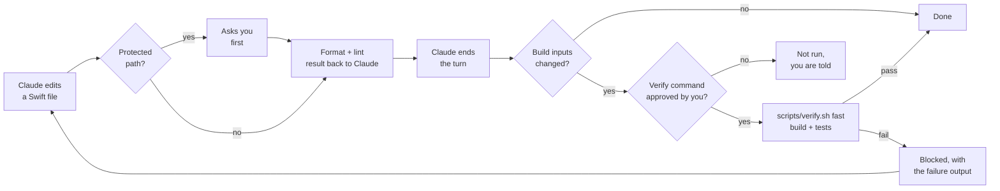

<p align="center">
  
</p>

<p align="center">
  <a href="https://github.com/davidelarocca/swift-harness/actions/workflows/ci.yml"></a>
  <a href="https://github.com/davidelarocca/swift-harness/releases/latest"></a>
  
  
  <a href="LICENSE"></a>
</p>

<p align="center">
  <b>A Claude Code plugin for native macOS apps.</b><br>
  A reuse-first SwiftUI design system workflow and automatic quality gates (format, lint, build, test),<br>
  so Claude stays consistent as your project grows.
</p>

<p align="center">
  <a href="#quick-start">Quick start</a> ·
  <a href="#how-it-works">How it works</a> ·
  <a href="#configuration">Configuration</a> ·
  <a href="ROADMAP.md">Roadmap</a> ·
  <a href="README.it.md">Italiano</a>
</p>

```
/plugin marketplace add davidelarocca/swift-harness
/plugin install swift-harness@swift-harness
/swift-harness:setup
```

<p align="center">
  
  <br>
  <sub>A real Claude Code session. The end-of-turn check catches a failing test, Claude says so instead of hiding it, and fixes it when asked.</sub>
</p>

## Why

Step-by-step plans keep each Claude Code session focused, but they don't stop drift between steps. As a project grows, the same UI pattern (a notification pill, a hover button, a popover) gets rebuilt slightly differently in each feature, raw values spread across views, and visual and structural bugs follow.

swift-harness fixes this on three levels:

1. **The design system lives in code**, not in docs: tokens and shared components in a local Swift package.
2. **Claude knows where to look**: a short `CLAUDE.md`, path-scoped rules, a component registry and ADRs, loaded only when relevant.
3. **Checks are automatic**, not requests: hooks format, lint and verify, so "please don't hardcode values" becomes something Claude cannot skip.

## How it works



| Type | Name | What it does |
|---|---|---|
| Skill (you run it) | `/swift-harness:setup` | Bootstraps or retrofits a project: `CLAUDE.md`, `.claude/rules/`, `docs/` (architecture hub, design system, component registry, product map, layout contract, ADR template), `.swiftlint.yml`, formatter config, `scripts/verify.sh`, hook config. Never overwrites existing files. |
| Skill (you run it) | `/swift-harness:approve-verify` | Shows the project's verify command and the files it runs, then approves it for the end-of-turn check. Only you can run it. `/swift-harness:approve-verify revoke` removes the approval. |
| Skill (you run it) | `/swift-harness:approve-snapshots` | Shows the new images that failing snapshot tests left (with the changed pixels in red), and copies the ones you approve into the baselines folder. Only you can run it: tests never write a baseline. |
| Skill (you run it) | `/swift-harness:approve-security` | Shows what changed in the app's security settings since your last approval (entitlements, App Transport Security, sandbox and hardened runtime build settings), says which changes weaken protection, and records them as the new baseline when you agree. Until then, the end-of-turn check fails. |
| Skill (you run it) | `/swift-harness:doctor` | Read-only check of the setup: tools, config keys and values, leftover `{{...}}` placeholders, verify script and approval, formatter config, project structure and the last verification. One PASS / WARN / FAIL row per check, with the fix. Changes no file. |
| Skill (you run it) | `/swift-harness:audit` | Read-only audit of architecture, UI consistency and code health. Produces a prioritized report and an incremental migration plan. |
| Skill (you run it) | `/swift-harness:product-map` | Read-only map of the product from its code: entities, their pages, every place each one appears, relations, user-managed collections and action sets. Lists the gaps with evidence: items you cannot open from where they are shown, related items shown as plain text, lists you cannot rename or reorder, actions missing in some places. Writes `docs/PRODUCT_MAP.md` after you approve. |
| Skill (you run it) | `/swift-harness:port-to-ios` | Read-only assessment of a macOS app for iOS: each module and feature classed as share as is, share with adapter, UI adaptation, redesign or unavailable, with `file:line` evidence from `scripts/porting.sh`; target structure options compared; a status per platform that never says ready without a build and tests. Optional iOS Simulator build of the packages, only with your yes. Writes `docs/PORTING_PLAN.md` and nothing else. |
| Skill (automatic) | `ui-change` | Reuse-first procedure for any UI change: search the registry and the code, decide reuse, extend or create, implement with tokens, preview every state, update the registry. An entity shown in a new place keeps the links and actions it has elsewhere, per `docs/PRODUCT_MAP.md`. |
| Skill (automatic) | `design-system` | Local package layout, tokens, a shared presenter for pills and toasts, button styles, component gallery, snapshot tests, migration plan from hardcoded values. Includes Swift reference files. |
| Skill (automatic) | `feature` | Discover, plan, implement, verify, record: the loop for every feature or roadmap step. |
| Skill (automatic) | `adr` | Records an architecture decision and indexes it. |
| Subagent | `ui-reviewer` | Read-only review of a UI diff against the design system, the registry, the product map and the architecture rules. |
| Hook | SessionStart | Records the starting code state as a baseline (not as verified), warns if the last check failed on the same code, tells Claude when the verify command is not approved, and reports missing tools. After a compaction, it gives Claude a short checkpoint of facts instead: branch, files changed in the session, the verification result on the current code, what waits for you, the docs to reread. |
| Hook | PreToolUse | Asks for confirmation before Claude edits `project.pbxproj`, a protected path or a snapshot baseline with the Edit or Write tools. Not a sandbox: see [Limitations](#limitations). |
| Hook | PostToolUse | Formats and lints the Swift file just edited (only files inside the project); lint results, formatter changes and failures, and SwiftLint configuration errors go back to Claude. After a `Package.swift` edit, checks the [architecture contract](#how-it-works). |
| Hook | Stop | Runs your fast verification and the architecture contract check before Claude ends a turn, only when build inputs changed (Swift code, project and build settings, resources), and only once you approved the command. Tells you if the contract changed during the session. Also tells you when snapshot baselines changed in the session without `/swift-harness:approve-snapshots`, including through shell commands. Also: security settings changed since your approval fail the check; protected files changed outside Edit and Write, and snapshot baselines changed without approval, are reported to you. |

The always-on context cost is about 770 tokens per session. Skills load their full instructions only when they are used. Every hook does nothing in a project without `.claude/swift-harness.json`, so your other projects are untouched.

<details>
<summary><b>How the end-of-turn check behaves</b></summary>

- The verify command runs only after you approve it with `/swift-harness:approve-verify`. The approval covers the project path, the command and the content of each file the command names, and is stored outside the repository. Until then, or after any of those change, the check does not run it and tells you once per code state; `lintBlocking` still applies.
- Code unchanged since the session started or since the last successful check: nothing runs. The starting state is a baseline, not a pass: if it was already broken, the first change in the session runs the check and shows it.
- Code changed and the check fails: Claude is blocked and receives the last 60 lines of output.
- Claude tries to stop again without changing anything: it may stop, and you get a warning.
- After `maxAttempts` consecutive failures (default 3): Claude stops and you decide.
- With `lintBlocking: true`, files that failed SwiftLint after an edit are linted again here. A hook cannot undo an edit that already happened, so this is where it is caught: the turn is not recorded as passed until those files are clean.
- "Changed" means any build input: Swift files (including `Package.swift`), `Package.resolved`, workspaces, `.pbxproj`, `.xcconfig`, plists, entitlements, asset and string catalogs, `Resources/` folders, everything under SwiftPM `Sources/` and `Tests/` folders (resources, fixtures), snapshot baselines, `scripts/`, lint and harness config. `.build`, DerivedData, Xcode per-user state (`xcuserdata`) and `.DS_Store` are ignored.
- A result belongs to the code and to the plugin version. After a plugin update, a pass or failure recorded by the old version no longer counts. Unchanged code is not re-run on its own: the check runs at the end of the next turn that changes build inputs, and until then `/swift-harness:doctor` shows the code as not verified.
- A failure survives a new session: on startup or resume, Claude is told if the last check failed on the current code.
- Works per git worktree, so parallel agents each verify their own checkout.

</details>

<details>
<summary><b>Architecture contracts (SwiftPM)</b></summary>

In a project split into SwiftPM targets, the compiler enforces the declared dependencies but not the declarations: to make a change compile, an agent can add `"Services"` to the `UI` target in `Package.swift`, and the boundary is gone. `docs/architecture-contracts.json` lists the dependencies each target may have:

```json
{
  "version": 1,
  "packages": {
    ".": {
      "App": ["Features", "DesignSystem"],
      "Features": ["Domain", "DesignSystem"],
      "Domain": ["swift-collections/Collections"],
      "DesignSystem": []
    }
  }
}
```

- Keys are package folders relative to the repository (`"."`, `"Packages/Core"`). Local targets are named as in `Package.swift`, products of other packages as `package/product`. Anything not listed is not allowed, and a target missing from the contract fails too: a new module is a decision. Test targets are checked only when listed.
- The graph comes from `swift package dump-package`, with no parsing of Swift source. It runs at the end of each turn that changed build inputs and right after Claude edits a `Package.swift`, only once you approved the verify command: reading the manifest runs it, as the build does.
- A violation blocks the turn with the package, target and dependency named. To allow a new dependency, add it to the contract, ideally with an ADR.
- If the contract changes during a session, you get the allowed dependencies added and removed at the end of the turn. Claude can still edit it (add it to `protectedPaths` so edits ask first), but not silently.
- `/swift-harness:doctor` checks the file and its package folders without running any manifest. Projects without SwiftPM packages, or with a single target, have nothing to check.

</details>

<details>
<summary><b>A component registry that stays true</b></summary>

`docs/COMPONENT_REGISTRY.md` is what Claude reads before building UI, so a wrong entry sends it to a file that moved or a type that was renamed. The registry is checked like code:

- At the end of each turn that changed code or the registry: every File exists and declares the Name (`struct`, `class`, `func`, ...), IDs and names are unique, and a Retired ID is no longer listed. A problem blocks the turn with the registry line, like a failing build. It reads Markdown only, so it runs without the verify approval.
- After Claude edits a file in `registry.sources`: a note names the views, modifiers and styles in that file the registry does not list, and the entries whose File it is, as a reminder to update them in the same change. Not blocking.
- `/swift-harness:doctor` shows the result and every component not listed.

Columns are found by their header: the Components table needs Name and File. A registry in another format is reported by doctor and never blocks. "Component" means a top-level, non-private type that conforms to `View`, `ViewModifier`, `Layout`, `Shape`, an AppKit or UIKit representable or a `*Style` protocol: presenters and other shared types are checked when listed, but not detected when missing. List views that are not for reuse (galleries, building blocks) under Internal. Which component a feature should reuse is still Claude's judgment, guided by the registry and the `ui-change` skill.

</details>

<details>
<summary><b>Screens that hold up at every window size</b></summary>

Claude builds a screen at the size of its preview. `docs/LAYOUT_CONTRACT.md` gives each main screen the sizes it must hold: Min, Default, Max, a width below which it switches to a compact layout and what changes there, and the popovers and windows it opens. The project's tests measure it:

```swift
#expect(LayoutContract.check("LibraryView") { LibraryView() } == [])     // the content
#expect(LayoutContract.check("LibraryWindow") { LibraryWindow() } == []) // the window that shows it
```

- `LayoutContract.check` (copied by setup into a test target from `templates/tests/LayoutContract.swift`) proposes each size of the row to the view with `NSHostingController.sizeThatFits(in:)` and reports any size where the content needs more room: "at 560x400 it needs 857 pt of width". For the window, it checks the declared minimum is Min, so the window neither shrinks to nothing nor stops above Min, and that it does not grow past Max. In a package test target they run in `scripts/verify.sh fast`, so a layout that breaks blocks the end of the turn like any failing test; in an Xcode test target the generated script runs tests in `full` mode only.
- At the end of each turn, `scripts/layout.sh` checks the contract itself: every View exists in its File, every Window is declared, every one is measured by a test, sizes are sizes. It reads Markdown and Swift files as text, so it runs without the verify approval.
- After Claude edits a file that draws a screen in the contract, a note gives its sizes. `ui-change`, the UI rule and `ui-reviewer` read the contract; the reviewer checks what the tests cannot see.

A view that takes any width and asks for none cannot be measured, and the check fails with what to do instead of passing: `NavigationSplitView`, `HSplitView`, `List` and `Table` clip what does not fit without reporting it. Most main windows are split views, so the pages of the detail column and the sidebar get rows of their own. Content that takes any width but has a width of its own (text that wraps, or a `.frame(minWidth: 0, maxWidth: .infinity)` that hides its content) cannot be told apart: it passes with a note on the test output. Found on a ~97k-line app, where both main screens passed without being measured.

The content is measured without the window's frame: a `.frame(minWidth:)` around a view hides content wider than the frame, so the window's minimum belongs to a small window view, measured on its own.

On the running app, a UI test looks at what the window really shows. `LayoutAudit` (from `templates/tests/LayoutAudit.swift`) reads the accessibility tree once and fails for every element cut by the edge of its window, sheet or popover outside a scroll view, and every text over another text, with the frames:

```swift
LayoutAudit.shrinkWindow(app)   // macOS: drags the window to its minimum size
try LayoutAudit.check(app)      // 'play' is cut by the left edge: (417, 390, 150x24) in (510, 285, 280x312)
```

It works on macOS and on an iOS simulator (iPhone, iPad, the largest Dynamic Type size through `LayoutAudit.largestText`), measured on a fixture in CI: two cut buttons and two overlapping labels are found, a scrolling list past its edge is not, the fixed screen passes. Frames in the tree are not clipped, which is what makes an edge measurable. It catches the overflow that `.frame(minWidth: 0, maxWidth: .infinity)` hides from `LayoutContract`. Not measured: text truncated by its own frame, content under the iOS status bar, and where popovers open; those are review checks, on screenshots when the project captures them (below).

</details>

<details>
<summary><b>Design review on screenshots</b></summary>

Code shows tokens and modifiers, not whether rows line up or two screens look alike. The project's tests can save images of each screen for the `ui-reviewer` agent:

```swift
#expect(Screenshot.capture("LibraryView") { LibraryView() } == [])
```

- `Screenshot.capture` (copied by setup next to `LayoutContract.swift`, from `templates/tests/Screenshot.swift`) renders the screen in an offscreen window at the Min and Default sizes of its layout contract row, or at sizes you pass, in light and dark, and saves PNG images with a `.json` beside each (screen, state, platform, size, scale, OS, source file) to `.build/swift-harness/screenshots/`. In a package test target it runs in `scripts/verify.sh fast` at the end of every turn, so the images follow the code; in an Xcode test target, in `full` mode. A capture that looks like an empty window is reported as a problem; a view of one color is saved. The reviewer reports an image older than its source file as stale.
- `ui-reviewer` opens the images of the changed screens and of screens next to them, and reports what it sees: edges that do not line up, spacing that differs between screens built the same way, hierarchy, truncation, dark-mode contrast. Each finding names the image and the `file:line` that draws it. These are review notes, not a gate: comparing with approved images is the job of the snapshot tests (below).
- Why a window: `ImageRenderer` draws a placeholder for `List` and other AppKit-backed controls, and `NSView.cacheDisplay` drops SwiftUI text. The window server capture shows the screen as the app draws it.

Measured on a small fixture, 3 runs per arm ([results](tests/smoke/RESULTS.md)): the defects planted in the code were found with and without images; with images the reviewer gave positions instead of guesses, never misdescribed the layout, and found a rendering defect the code-only review missed every time.

</details>

<details>
<summary><b>Visual regression with approved baselines</b></summary>

A shared component changed for one screen can shift every other screen that uses it. The project's tests compare each component with images you approved:

```swift
#expect(Snapshot.verify("PillView", sizes: ["320"], state: "long-text") { PillView(pill: .success(longTitle)) } == [])
#expect(Snapshot.verify("PillView", sizes: ["320"], locale: "ar") { PillView(pill: .success("Added")) } == [])
```

- `Snapshot.verify` (copied by setup next to `Screenshot.swift`, from `templates/tests/Snapshot.swift`) renders the view the same way as the screenshots, in light and dark, and compares each image with its baseline in `snapshots/`. `locale:` sets the language and the text direction, so a gallery covers long languages and right to left.
- A test never writes a baseline. A missing or different image fails and names the region that changed ("85 of 151200 pixels differ, within x 96-110, y 118-126 pt"); the new image and a diff with the changed pixels in red wait in `.build/swift-harness/snapshots/`. You look at them and approve with `/swift-harness:approve-snapshots`, which copies them into `snapshots/` to commit.
- Claude cannot replace a baseline quietly: the guard asks before an Edit or Write in `snapshots/`, and at the end of a turn you are told about baselines changed without approval, shell commands included. In real sessions, Claude handed the approval back to the user even when asked to update the baselines ([results](tests/smoke/RESULTS.md)).
- Baselines are pinned to the macOS version and display scale they were made on. On another version an image is reported as not compared, never as a match.

</details>

<details>
<summary><b>Keyboard, focus order and Reduce Motion</b></summary>

A component that works only with a pointer, or a screen whose Tab order jumps around, passes every other check. Setup offers two test helpers, built on what a test can see on macOS 26 and 27 (measured):

```swift
let keys = KeyboardCheck.host { SaveBar(onSave: { saved = true }, onCancel: { cancelled = true }) }
keys.press(.return)                        // the default action
keys.press(.escape)                        // cancel, onExitCommand, onKeyPress
keys.press("f", modifiers: .command)       // its shortcut

try FocusOrder.check(app, ["search", "sort", "play", "shuffle", "trackList"])   // a UI test
```

- `KeyboardCheck` (unit tests, from `templates/tests/KeyboardCheck.swift`) hosts a view in an offscreen window and presses keys on it; the test asserts what the action did. In a package test target it runs in `scripts/verify.sh fast`. It cannot check Tab or focus order (a test process has no key view loop), menu commands, or shortcuts that differ only by Shift (SwiftUI confuses them in a test process; the real app does not).
- `FocusOrder` (UI tests, from `templates/tests/FocusOrder.swift`) presses Tab in the launched app and checks that focus visits the controls in the order you give, comes back to the first, and that Shift-Tab goes back. Controls join the Tab loop only when Keyboard navigation is on in System Settings: with it off the test is **skipped**, never passed. CI turns it on with `defaults write -g AppleKeyboardUIMode -int 2`. macOS has no public API for keyboard focus in UI tests; the helper reads an undocumented attribute and fails, rather than passes, if it stops working.
- Reduce Motion cannot be turned on from a test (`accessibilityReduceMotion` is read-only). The design system reference has `@ReduceMotion`, which a test or preview overrides with `.environment(\.reduceMotionOverride, true)`, and `Motion.moving(_:reduced:)`, which drops a moving animation or turns a moving transition into a fade. The `ds_motion_without_reduce` rule reports moving transitions that skip it.
- What stays a review: actions reachable only by click or hover, focus rings, Escape on presented UI, menu shortcuts, and animations started with `withAnimation`.

</details>

<details>
<summary><b>The SwiftLint design system rules</b></summary>

The generated `.swiftlint.yml` adds six custom rules that flag raw visual values outside the design system and tests, and one for Reduce Motion that applies everywhere:

| Rule | Flags |
|---|---|
| `ds_hardcoded_color` | `Color(red:…)`, `NSColor(calibratedRed:…)`, color literals |
| `ds_hardcoded_font_size` | `.system(size:)`, `NSFont.systemFont(ofSize: 12)`, `.custom(_, size:)` |
| `ds_hardcoded_padding` | `.padding(12)`, `.padding(.horizontal, 8)` |
| `ds_hardcoded_spacing` | `VStack(spacing: 8)` (zero is allowed) |
| `ds_hardcoded_radius` | `cornerRadius: 8`, `.cornerRadius(6)` |
| `ds_hardcoded_animation` | `.easeInOut(duration: 0.3)`, `.spring(response: 0.4…)` |
| `ds_motion_without_reduce` | `.transition(.move(edge: .top))`, `.slide`, `.push`, `.offset`, `.scale` without `Motion.moving(_:reduced:)` (one line) |

They start as warnings, which double as the migration to-do list. Switch a rule to `error` once its count reaches zero.

</details>

## Tested in real Claude Code sessions

A quality tool has to be checked itself. Every release goes through:

- **273 automated checks** of the hooks, templates and skills (`tests/run.sh`), run in CI with macOS `/bin/bash` 3.2, plus ShellCheck and a build of the Swift reference files.
- **A smoke test in real Claude Code sessions** (`tests/smoke/`): 16 scenarios for the hooks, 6 for reusing UI components and 3 for product coherence (4 of them baselines without the plugin), with their invariants checked automatically. Latest full run of the hook scenarios: 62/62 invariants passed ([results](tests/smoke/RESULTS.md)).

What Claude did in those sessions:

| Situation | What Claude did |
|---|---|
| Asked to edit a protected folder | Did not work around the guard. Showed the edit it wanted to make and asked for approval. |
| The requested change broke a test, with "only change this file" | Left the test alone, explained the failure and asked before updating it. |
| `.swiftlint.yml` had a broken rule | Did not touch the config. Reported that the problem was in the config, not in its change. |
| Padding value with no matching token | Kept the requested value, surfaced the lint warning and offered two options: a new token or an existing one. |
| Asked for a confirmation with Undo, with a shared pill already in the app that had no action | Extended the shared pill in the design system instead of building a banner, and updated the registry, previews and tests. A session without swift-harness also extended the pill, with no tests or previews. |

Details and history: [tests/smoke/RESULTS.md](tests/smoke/RESULTS.md).

## Quick start

**Requirements:** macOS with Xcode, Claude Code with plugin support, and `jq`. `swiftlint` and `swiftformat` are recommended; Apple's `swift-format`, bundled with Xcode, also works.

```bash
brew install jq swiftlint swiftformat
```

**Install**, in Claude Code:

```
/plugin marketplace add davidelarocca/swift-harness
/plugin install swift-harness@swift-harness
/plugin install swift-lsp@claude-plugins-official   # recommended: type diagnostics after every edit
```

On Claude Code 2.1.275 or later, the first two lines can be one: `/plugin install swift-harness --marketplace davidelarocca/swift-harness`.

> [!IMPORTANT]
> The end-of-turn check runs the verify command configured in the project, so it runs nothing until you approve that command with `/swift-harness:approve-verify`, and it asks again when the command or its script changes. Approving it means trusting the project's build. See [SECURITY.md](SECURITY.md).

**Use:**

1. Open your project in Claude Code and commit any pending work.
2. Run `/swift-harness:setup`. It detects the project structure, asks at most four questions (design system location, formatter, protected paths, verify commands) and generates the files on a `chore/swift-harness-setup` branch.
3. Review `scripts/verify.sh` and run `/swift-harness:approve-verify`, so the end-of-turn check can run it. `/swift-harness:doctor` shows anything still missing.
4. For an existing codebase, switch to plan mode and run `/swift-harness:audit`.
5. From then on, `ui-change`, `feature`, `design-system` and `adr` trigger on their own when relevant, and the hooks run automatically.

## Configuration

`.claude/swift-harness.json` in your project:

```json
{
  "format": "swiftformat",
  "lint": "swiftlint",
  "lintBlocking": false,
  "verify": {
    "enabled": true,
    "command": "scripts/verify.sh fast",
    "maxAttempts": 3
  },
  "protectedPaths": ["Sources/Audio/"],
  "guardPbxproj": true,
  "registry": {
    "sources": ["Packages/DesignSystem/Sources"]
  },
  "layout": {
    "enabled": true
  }
}
```

| Key | Values | Default |
|---|---|---|
| `format` | `swiftformat`, `swift-format` (needs a `.swift-format` file, see below), `none` | `swiftformat` |
| `lint` | `swiftlint`, `none` | `swiftlint` |
| `lintBlocking` | `true` blocks Claude on SwiftLint errors and on SwiftLint failing to run or reporting an invalid configuration, and re-checks those files at the end of the turn. If SwiftLint is not installed, the end-of-turn check fails after code changes instead of counting unlinted code as passing. `false` only reports | `false` |
| `verify.enabled` | run the Stop check | `true` |
| `verify.command` | any shell command, exit 0 means pass | `scripts/verify.sh fast` |
| `verify.maxAttempts` | consecutive failures before Claude may stop | `3` |
| `verify.inputs` | files or folders covered by the approval in addition to the files the command names, such as a script the command calls through quotes or `make` | `[]` |
| `protectedPaths` | path prefixes relative to the repo root that require approval before an Edit or Write (`../` and symlinks are resolved, also when the entry itself is a symlink) | `[]` |
| `guardPbxproj` | ask before edits to `*.pbxproj` | `true` |
| `registry.enabled` | check the component registry at the end of the turn, when the file exists | `true` |
| `registry.path` | the component registry, relative to the repo root | `docs/COMPONENT_REGISTRY.md` |
| `registry.sources` | design system folders where views, modifiers and styles missing from the registry are looked for | `[]` |
| `layout.enabled` | check the layout contract at the end of the turn, when the file exists | `true` |
| `layout.path` | the layout contract, relative to the repo root; `LayoutContract.check` reads it from the same config | `docs/LAYOUT_CONTRACT.md` |
| `screenshots.path` | where `Screenshot.capture` saves images and `ui-reviewer` looks for them, relative to the repo root | `.build/swift-harness/screenshots` |
| `snapshots.path` | the approved snapshot baselines `Snapshot.verify` compares with, inside the repo; only `/swift-harness:approve-snapshots` writes there, and the guard asks before an edit | `snapshots` |
| `security.enabled` | compare the app's security settings with the ones you approved at the end of each turn (`false` turns it off) | `true` |

With `swift-format`, keep a `.swift-format` file in the repository root (setup creates one). Without it, swift-format applies its defaults, including 2-space indentation, to every file Claude edits, and SessionStart warns about it.

After each Swift edit Claude gets one short note per tool: what the formatter changed (up to 12 lines), and the SwiftLint result, including "no issues" or "excluded", so it can report what was actually checked.

The hooks append `/opt/homebrew/bin` and `/usr/local/bin` to `PATH` when missing, for sessions started from the GUI. Set `SWIFT_HARNESS_EXTRA_PATH` (colon-separated, empty for none) to change that list.

The generated `scripts/verify.sh` runs `swift test` on local packages and an incremental `xcodebuild build` in `fast` mode, and `xcodebuild test` plus strict SwiftLint in `full` mode. It uses a separate DerivedData folder so it never fights with an open Xcode. It never reports PASS without running at least one check: with no scheme and no package it fails with `NOT CONFIGURED`, and a listed package that does not exist is a failure. `PLATFORMS` lists where the scheme is built and tested (`"macOS"`, `"iOS"`, or both): iOS builds for any simulator in `fast` mode, without booting one, and runs its tests on `IOS_SIMULATOR` in `full` mode. When a listed platform got no build or test (packages only: `swift test` runs on this Mac), the result is `PARTIAL`, never `PASS`. `/swift-harness:doctor` compares `PLATFORMS` with the platforms in `project.pbxproj` and `Package.swift` and checks the simulator exists.

<details>
<summary><b>What the setup generates in your project</b></summary>

```
CLAUDE.md                      short, imports docs/ARCHITECTURE.md
.claude/
  swift-harness.json           turns the hooks on
  rules/
    ui-features.md             loads when Claude touches feature UI files
    design-system.md           loads when Claude touches the design system
    architecture.md            loads for any Swift file
docs/
  ARCHITECTURE.md              hub: modules, data flow, protected areas, links
  DESIGN_SYSTEM.md             principles, tokens, interaction patterns
  COMPONENT_REGISTRY.md        one row per shared component, plus "To consolidate"
  PRODUCT_MAP.md               entities, their pages, relations and actions
  LAYOUT_CONTRACT.md           window sizes each main screen must hold
  adr/0000-template.md
.swiftlint.yml
.swiftformat or .swift-format  formatter config (4 spaces, 160 columns)
scripts/verify.sh
```

</details>

## Roadmap

Next up: **v1.6.0, reliable sessions, keyboard and performance**: per-session state, keyboard and focus checks, a layout audit from the accessibility tree, a docs reference check and a performance budget. Then v1.7.0, assisted macOS to iOS porting, which waits for a real port. The README says macOS until a real iOS app passes. See the full [roadmap](ROADMAP.md).

## Limitations

- **The verify approval covers what the command names, not everything it reads.** The command is split on spaces, not parsed as shell: with quotes or shell syntax and no `verify.inputs`, the approval shows as `approved, partial coverage` (also in `/swift-harness:doctor`), and listing the scripts in `verify.inputs` covers them. An input outside the project, or a folder with a link that leads outside it, cannot be covered, so the approval is refused. A `Makefile` behind `make verify`, or a script that `verify.sh` sources, can change without a new approval. Approving also means trusting the project's build (Xcode Run Script phases, SwiftPM manifests and plugins). See [SECURITY.md](SECURITY.md).
- **The registry check is about entries, not reuse.** It proves each entry points to a real declaration and finds unlisted views, modifiers, layouts and styles in `registry.sources`. It does not decide whether a new view duplicates an existing one. Editing only the registry also re-runs the fast verification at the end of the turn, since the registry is part of the checked state.
- **The layout contract measures room, not looks.** It proves a screen does not need more space than its window gives at each size, and that the window declares its sizes. Text that truncates and popovers that open outside the window are left to review; cut and overlapping content is found by `LayoutAudit` in UI tests. A split view, a `List` or a `Table` is measured through the pages it holds, which need rows of their own, and a stretched frame only gets a note; a UI test on the real window is the stronger check there. The measuring tests cannot run in a test target hosted by a sandboxed app, which cannot read `docs/`: use a package or unhosted test target, or pass `contract:`. macOS only for now; iOS size classes come with [#40](https://github.com/davidelarocca/swift-harness/issues/40).
- **Screenshot review is a judgment, not a check.** The images are evidence for the reviewer; a misaligned row does not fail anything. Capturing needs a logged-in session with a window server (Xcode, `swift test`, GitHub macOS runners) and a test target that can read and write the project: a sandboxed host app cannot, so use a package or unhosted test target, or pass `sizes:`, `source:` and a writable `output:`. Images depend on the macOS version and display scale. macOS only for now.
- **Architecture contracts cover SwiftPM targets only.** Dependencies between Xcode targets, and imports that the build allows through a transitive dependency, are not checked.
- **The protected-path guard is not a sandbox.** It covers the Edit, Write and MultiEdit tools only; a shell command run through Bash can still change a protected file. Such a change is reported to you at the end of the turn (the file, changed or deleted), after the fact: detection, not prevention. For hard limits use Claude Code [permission rules](https://code.claude.com/docs/en/permissions) (`deny`).
- The Swift reference files in the `design-system` skill are examples to adapt, not a library.
- **Snapshot baselines are pinned to one macOS version and display scale.** Text and controls draw differently on other versions, so on a Mac or runner that differs the images are reported as not compared, not as passed: compare on the Mac the baselines were made on (GitHub's runners usually run an older macOS). On macOS, `dynamicTypeSize` does not change how SwiftUI text is drawn, so larger text is a state the project draws itself. Focus, keyboard navigation and Reduce Motion are not covered by snapshots ([#52](https://github.com/davidelarocca/swift-harness/issues/52)).
- With Xcode 26, `swift build` and `swift test` copy a package's asset catalog without compiling it, so design-system colors do not resolve in those test runs. Run color-dependent tests with `xcodebuild test`; Xcode 27 compiles the catalog either way.
- **"Changed" is a list of file patterns, not the build graph.** In an Xcode project with synchronized folders, a resource of an unlisted type outside `Resources/` (say `App/data.json`) does not count as a change. A new SwiftLint or Xcode version does not invalidate a pass either: only the code and the plugin version do.
- The Stop check runs on your machine and takes as long as your fast verification. Keep `fast` under about two minutes.

## Contributing

Issues, ideas and pull requests are welcome: see [CONTRIBUTING.md](CONTRIBUTING.md). Questions go to [Discussions](https://github.com/davidelarocca/swift-harness/discussions), and security problems to [private reporting](SECURITY.md).

<details>
<summary><b>Repository layout and development</b></summary>

```
.claude-plugin/marketplace.json
plugins/swift-harness/
  .claude-plugin/plugin.json
  skills/        setup, approve-verify, approve-snapshots, approve-security, doctor, audit, product-map, port-to-ios, ui-change, design-system, feature, adr
  agents/        ui-reviewer
  hooks/         hooks.json
  scripts/       hook scripts (bash + jq)
tests/
  run.sh         hook and verify.sh tests (bash, git, jq; tools are faked)
  ios-fixture.sh verify.sh and doctor on a macOS + iOS package with real Xcode (--full: on a simulator)
  smoke/         the same hooks inside real Claude Code sessions
  fixtures/      SwiftPM package that compiles the design-system references
docs/assets/     logo, banner, demo (and the vhs tape that records it)
.github/         CI, issue forms, pull request template
```

To try local changes without reinstalling: `claude --plugin-dir ./plugins/swift-harness`. After a release, update with `/plugin marketplace update swift-harness`.

</details>

## License

[MIT](LICENSE)
